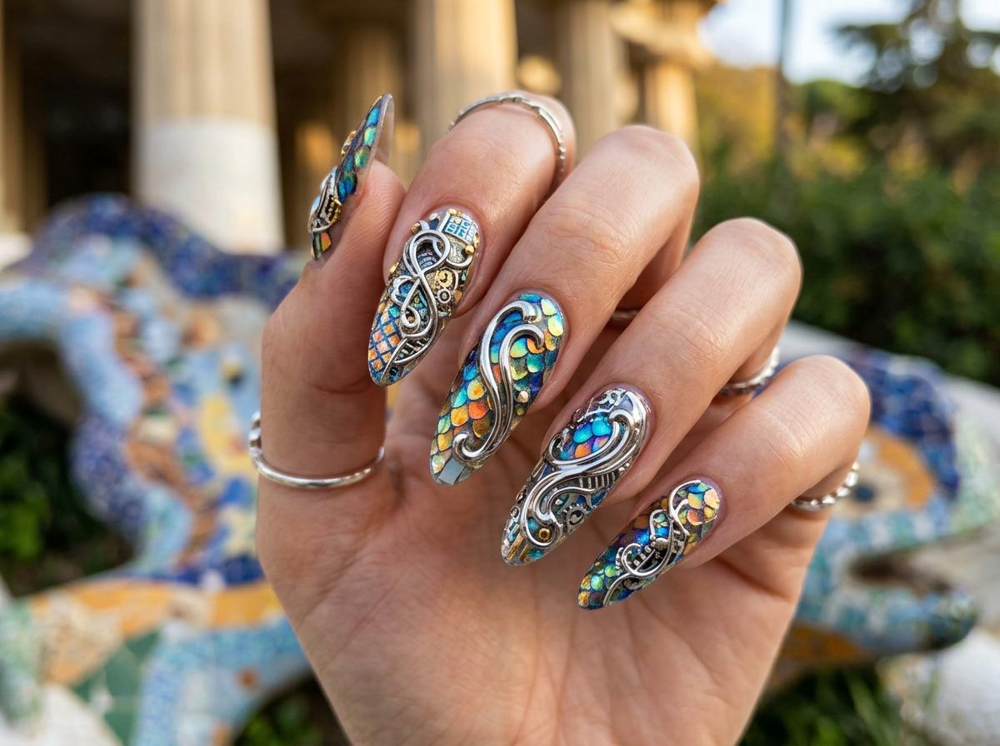
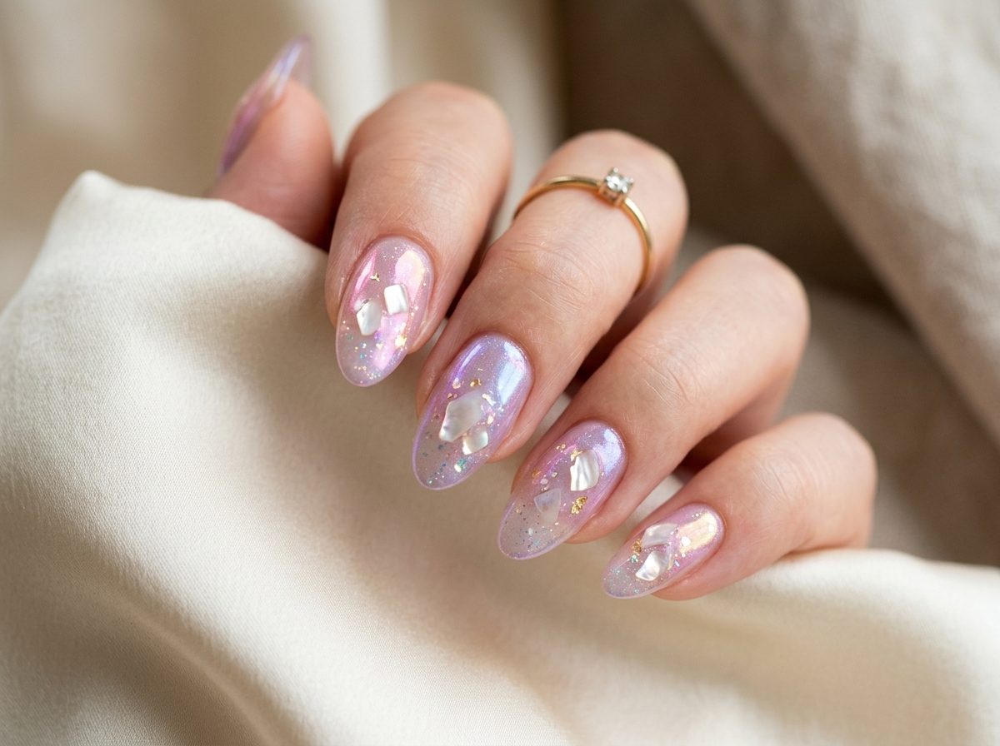

# ✦ NAILIX — Haute Manicure Art Network ✦
### *Cyberpunk × Antoni Gaudí × Van Gogh Aesthetic Social Ecosystem*

<p align="center">
  
</p>

<p align="center">
  <a href="https://onyx-aura.ai.studio/"></a>
  
  
  
  
  
</p>

---

## 🏛️ О проекте / About Nailix

**Nailix (Onyx Aura)** — это кроссплатформенная экосистема для ценителей высокой эстетики маникюрного искусства, объединяющая футуризм Cyberpunk, органические мозаичные формы Антонио Гауди и экспрессионизм Винсента Ван Гога.

Платформа решает задачи люксовых нейл-ателье, топ-мастеров и клиентов: от интеллектуального бронирования и синхронизации с персональными календарями (Google / Apple / Outlook) до инженерных прототипов круговой модерации и крипто-платежей.

> ⚖️ **Архитектурная честность**: В соответствии с [Каноническим Манифестом AI-разработчика](./MANIFEST_CANONICAL_AI_DEVELOPER.md) все модули классифицированы в [Карте Реальности](./docs/REALITY_MAP.md). Модули, находящиеся в режиме математической симуляции (P2P Swarm, Escrow, DAO-жюри), несут явную марку **`[SIM]`**.

---

## ✨ Ключевые возможности / Core Highlights

### 1. 📅 Интеллектуальный календарный сервис (Universal Calendar Sync) · 🟢 `REAL`
- **Мгновенная синхронизация в Google Calendar** через динамическую веб-ссылку с предзаполненными параметрами (название сессии, студия, адрес, детали мастера).
- **Экспорт в Apple Calendar / Microsoft Outlook** через генерацию стандартизированного файла `.ics` (iCalendar RFC 5545) с правильной временной зоной и напоминаниями.
- Управление подтвержденными записями в модальном окне «Мои записи».

### 2. 💅 Галерея Высокого Нейл-Арта (Haute Couture Gallery) · 🟢 `REAL`
- Интерактивный каталог эксклюзивных дизайнов с фильтрами по стилям (Sculptural 3D Chrome, Gaudí Mosaic, Aurora Glass, Cyberpunk Neo-Goth, Velvet Cat-Eye).
- Полноэкранный Lightbox с деталями материалов, времени работы и прямым переходом к бронированию конкретного образа.
- 100% локальное хранение всех 27 HD-ассетов (нулевая зависимость от внешних хостингов).

| Gaudí Trencadís Mosaic | Cyberpunk 3D Chrome | Aurora Glass Prisms | Velvet Noir Cat-Eye |
|:---:|:---:|:---:|:---:|
|  |  |  |  |

### 3. 🤝 Жюри и Круг доверия (Friend Moderation Circle) · 🔴 `[SIM]`
- Система голосования арбитров (Accept / Reject / Needs Review) для разбора спорных работ.
- *Инженерный статус:* `[SIM]` — на текущем этапе консенсус эмулируется в локальном React State (`src/simulation/`). Реальный P2P-консенсус запланирован на Этапе 5.

### 4. 💎 Мультивалютный чекаут & CryptoCloud · 🔴 `[SIM]`
- Оплата услуг в традиционных фиатных валютах (EUR, USD).
- Модель **CryptoCloud / Escrow** (USDT, TON, BTC, ETH) с детерминированным хешированием SHA-256 через Web Crypto API.
- *Инженерный статус:* `[SIM]` — на текущем этапе работает локальный эмулятор `BroadcastChannel`. Полноценные смарт-контракты запланированы на Этапе 4.

### 5. 📱 Progressive Web App & Android Native Ready · 🟢 `REAL`
- Полноценная поддержка PWA с оффлайн-кешированием Service Worker (176 предзагруженных ресурсов).
- Тактильный отклик (Haptic Feedback) для мобильных устройств (`navigator.vibrate`).
- AR Try-on симулятор примерки дизайна ногтей через камеру смартфона.
- Готовая сборка APK для Android (`nailix.apk`).

### 6. 🗺️ Радар мастеров & Интерактивная карта студий · 🟢 `REAL`
- Геолокационный поиск ближайших сертифицированных ателье с точным расчетом дистанции по формуле гаверсинусов (Haversine formula).

---

## 🛠️ Стек технологий / Tech Stack

- **Frontend Core**: [React 19](https://react.dev/), [TypeScript 5](https://www.typescriptlang.org/)
- **Bundler & Tooling**: [Vite 8](https://vitejs.dev/)
- **Styling & Design System**: [Tailwind CSS v4](https://tailwindcss.com/), Custom Cyber-Gaudí Ornament Engine
- **Motion & Interactions**: [Motion (Framer Motion v12)](https://motion.dev/)
- **Icons**: [Lucide React](https://lucide.dev/)
- **PWA & Offline Engine**: [Vite Plugin PWA](https://vite-pwa-org.netlify.app/), Workbox with automatic cache updates
- **Calendar Engine**: RFC 5545 iCalendar generator + Google Calendar API URI builder

---

## 📂 Структура проекта / Project Structure

```bash
├── public/                 # Статические ассеты, PWA иконки, манифест
│   ├── assets/images/      # 27 локальных HD-изображений (портфолио, баннеры, аватары)
│   ├── icon.png            # Основная иконка приложения
│   ├── pwa-192x192.png     # PWA иконка 192px
│   ├── pwa-512x512.png     # PWA иконка 512px
│   └── nailix.apk          # Скомпилированный Android APK пакет
├── src/
│   ├── components/         # Компоненты интерфейса (Hero, Modal, Booking, Radar, etc.)
│   │   ├── CalendarSyncButtons.tsx      # Синхронизация с Google & Apple Calendar (.ics)
│   │   ├── ClientAppointmentsModal.tsx  # Управление записями клиента
│   │   ├── PortfolioGallery.tsx         # Витрина нейл-дизайнов
│   │   ├── BookingModal.tsx             # Форма записи к мастеру
│   │   ├── FriendModerationSection.tsx  # DAO жюри и консенсус друзей
│   │   └── ClientLocationMap.tsx        # Интерактивная карта ателье
│   ├── data/               # Исходные данные мастеров, портфолио и рекламы
│   │   ├── initialData.ts
│   │   └── advertisements.ts
│   ├── utils/              # Утилиты
│   │   ├── calendarSync.ts # Генератор .ics файлов и URL для Google Calendar
│   │   └── haptics.ts      # Виброотклик для мобильных браузеров
│   ├── App.tsx             # Корневой компонент с вкладками и маршрутизацией
│   ├── main.tsx            # Точка входа React + автообновление Service Worker
│   └── index.css           # Стили Cyber-Gaudí и шрифты
├── vite.config.ts          # Конфигурация Vite и PWA Workbox
└── package.json
```

---

## 🚀 Быстрый старт / Getting Started

### 1. Клонирование репозитория:
```bash
git clone https://github.com/PerfectFriend/Onyx-Aura.git
cd Onyx-Aura
```

### 2. Установка зависимостей:
```bash
npm install
```

### 3. Запуск сервера разработки:
```bash
npm run dev
```
Приложение откроется по адресу `http://localhost:3000`.

### 4. Сборка для продакшена:
```bash
npm run build
```
Готовая статическая сборка будет скомпилирована в директорию `dist/`.

---

## 🌐 Продакшен развертывание / Deployment

Официальный развернутый веб-интерфейс:
👉 **[https://onyx-aura.ai.studio/](https://onyx-aura.ai.studio/)**

---

<p align="center">
  <sub>Разработано для платформы <b>Nailix Haute Manicure Art Network</b>. Все права защищены.</sub>
</p>
